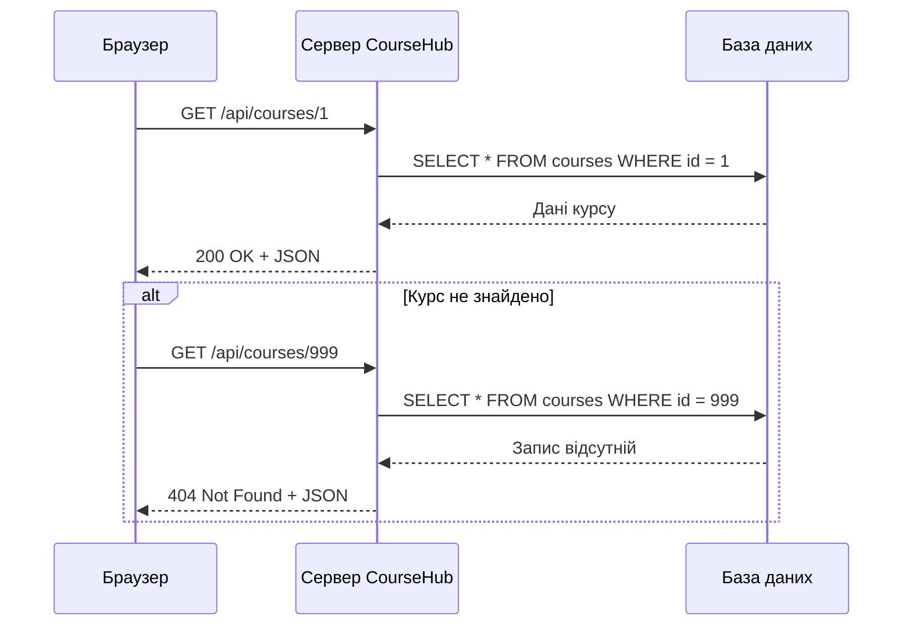

# Проєктування REST API платформи CourseHub

## 1. Призначення API

REST API платформи CourseHub призначений для керування онлайн-курсами, уроками, студентами та записами на курси.

API використовує протокол HTTPS, формат обміну даними JSON та стандартні HTTP-методи GET, POST, PUT, PATCH і DELETE.

Базовий шлях API: `/api`.

## 2. Основні ресурси

- **Course** - навчальний курс (`id`, `title`, `description`, `category`, `price`).
- **Lesson** - урок курсу (`id`, `courseId`, `title`, `content`, `order`).
- **Student** - студент (`id`, `name`, `email`).
- **Enrollment** - запис студента на курс (`id`, `studentId`, `courseId`, `enrolledAt`, `status`).

## 3. Перелік кінцевих точок

| № | Метод | Endpoint | Призначення | Успішний код | Можливі помилки |
|---|---|---|---|---|---|
| 1 | GET | `/api/courses` | Отримання списку курсів | 200 | 400 |
| 2 | GET | `/api/courses/{id}` | Отримання курсу за ID | 200 | 404 |
| 3 | POST | `/api/courses` | Створення нового курсу | 201 | 400, 401, 403, 422 |
| 4 | PUT | `/api/courses/{id}` | Повне оновлення курсу | 200 | 400, 401, 403, 404, 422 |
| 5 | PATCH | `/api/courses/{id}` | Часткове оновлення курсу | 200 | 400, 401, 403, 404, 422 |
| 6 | DELETE | `/api/courses/{id}` | Видалення курсу | 204 | 401, 403, 404 |
| 7 | GET | `/api/courses/{id}/lessons` | Отримання уроків курсу | 200 | 404 |
| 8 | GET | `/api/lessons/{id}` | Отримання інформації про урок | 200 | 403, 404 |
| 9 | POST | `/api/courses/{id}/lessons` | Додавання уроку до курсу | 201 | 400, 401, 403, 404, 422 |
| 10 | GET | `/api/students` | Отримання списку студентів | 200 | 401, 403 |
| 11 | GET | `/api/students/{id}` | Отримання інформації про студента | 200 | 401, 403, 404 |
| 12 | POST | `/api/enrollments` | Запис студента на курс | 201 | 400, 401, 403, 404, 409, 422 |
| 13 | GET | `/api/enrollments` | Перегляд записів на курси | 200 | 401, 403 |
| 14 | DELETE | `/api/enrollments/{id}` | Скасування запису на курс | 204 | 401, 403, 404 |

## 4. Параметри запитів

Для отримання списку курсів передбачено такі параметри:

| Параметр | Приклад | Призначення |
|---|---|---|
| `search` | `?search=javascript` | Пошук курсів за назвою |
| `category` | `?category=programming` | Фільтрація за категорією |
| `page` | `?page=2` | Номер сторінки |
| `limit` | `?limit=10` | Кількість записів на сторінці |
| `sort` | `?sort=price` | Сортування за ціною |

Приклад комбінованого запиту:

`GET /api/courses?category=programming&sort=price&page=1&limit=10`

Для перегляду записів на курси передбачено фільтри `studentId`, `courseId` та `status`.

## 5. Приклади JSON-відповідей

### Отримання курсу

**Запит:** `GET /api/courses/1`

**Статус:** `200 OK`

```json
{
  "id": 1,
  "title": "Основи JavaScript",
  "description": "Вступний курс із JavaScript",
  "category": "programming",
  "price": 0
}
```

### Створення запису на курс

**Запит:** `POST /api/enrollments`

**Тіло запиту:**

```json
{
  "studentId": 5,
  "courseId": 1
}
```

**Статус:** `201 Created`

**Приклад відповіді:**

```json
{
  "id": 12,
  "studentId": 5,
  "courseId": 1,
  "enrolledAt": "2026-10-24T12:00:00Z",
  "status": "active"
}
```

## 6. Формат повідомлень про помилки

Для всіх помилок використовується єдиний формат JSON:

```json
{
  "error": {
    "code": "COURSE_NOT_FOUND",
    "message": "Курс не знайдено",
    "status": 404
  }
}
```

Основні коди:

- `400 Bad Request` - некоректні параметри запиту.
- `401 Unauthorized` - користувач не авторизований.
- `403 Forbidden` - недостатньо прав доступу.
- `404 Not Found` - ресурс не знайдено.
- `409 Conflict` - конфлікт даних, наприклад повторний запис на курс.
- `422 Unprocessable Content` - помилки перевірки введених даних.

## 7. Правила доступу

Перегляд каталогу курсів доступний усім користувачам. Створення, редагування та видалення курсів і уроків дозволено лише користувачам із відповідними правами.

Студент може переглядати власні записи та записуватися на доступні курси. Адміністратор має розширені права керування курсами, студентами та записами.

## 8. Діаграма послідовності взаємодії клієнта із сервером

Сценарій: студент відкриває сторінку курсу на платформі CourseHub. Браузер надсилає GET-запит до сервера, який звертається до бази даних і повертає інформацію про курс у форматі JSON.



Діаграма відображає послідовність обміну HTTP-запитами та відповідями між браузером, сервером і базою даних, зокрема успішне отримання курсу та обробку ситуації, коли ресурс не знайдено.

## 9. Висновок

Спроєктовано REST API для платформи CourseHub, визначено основні ресурси, кінцеві точки, HTTP-методи, коди стану, параметри запитів і формат повідомлень про помилки. Створена специфікація є основою для подальшої реалізації серверної частини застосунку.