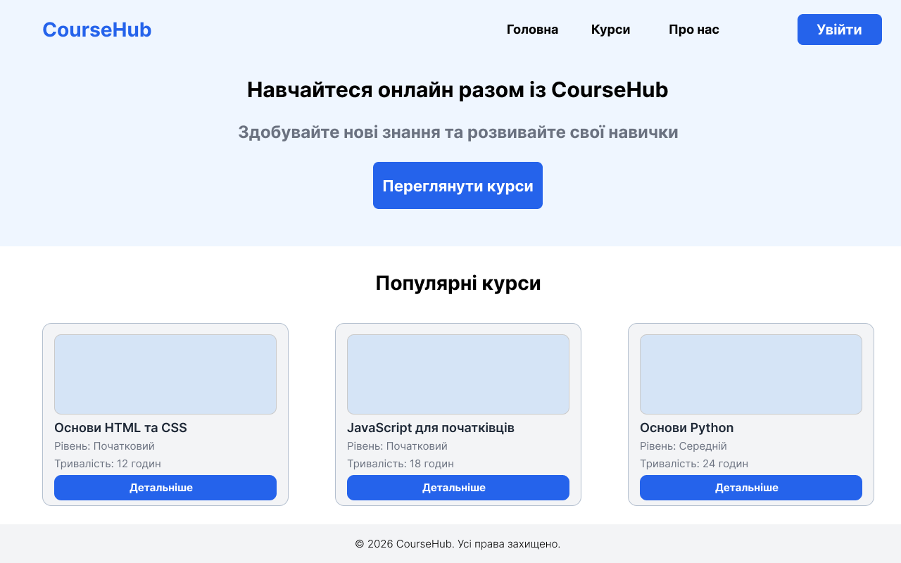
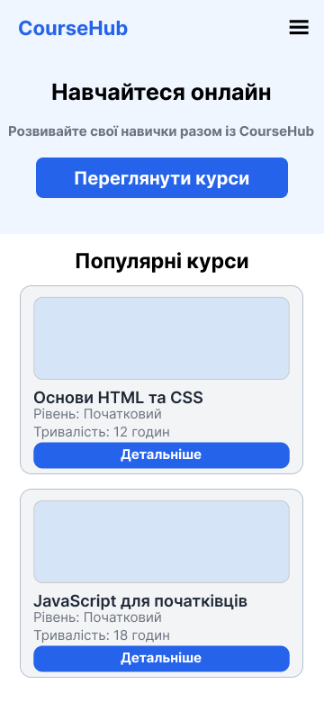
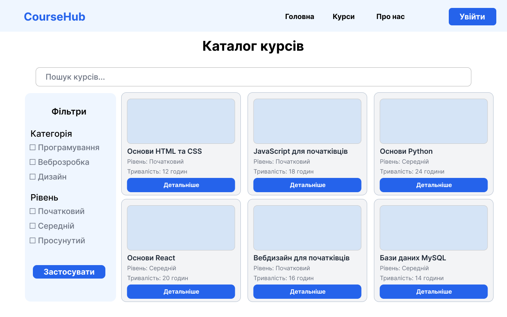
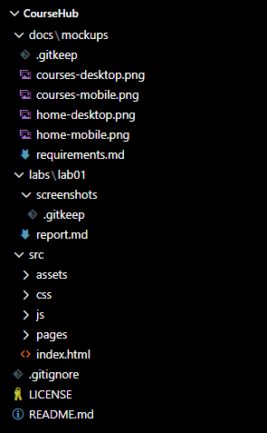
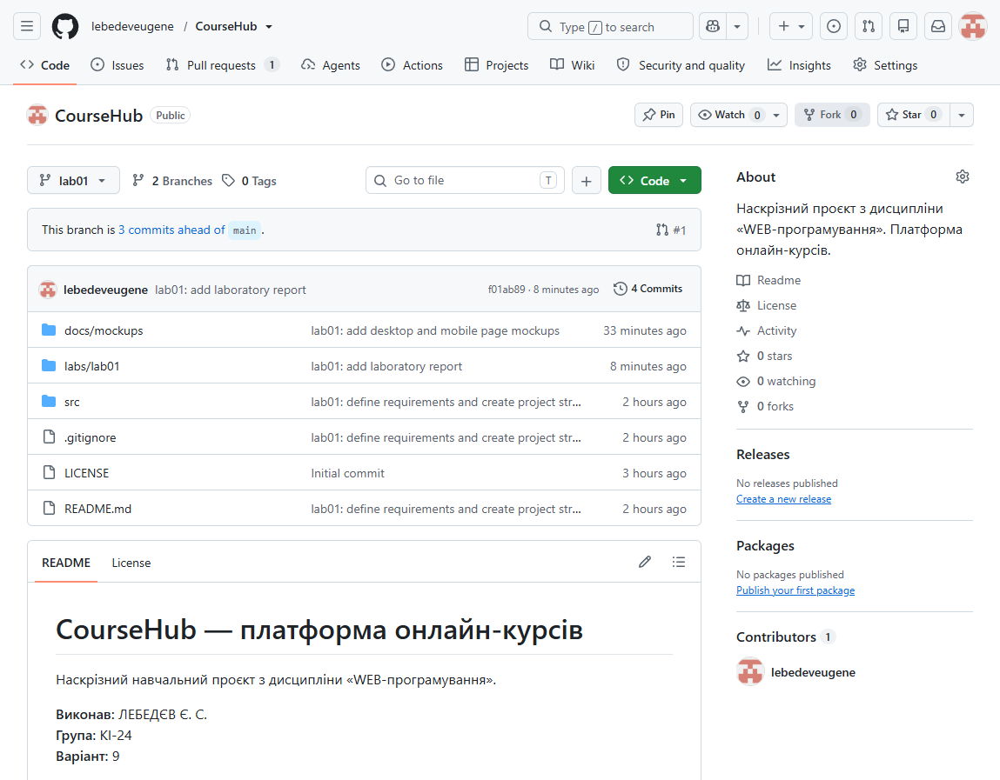
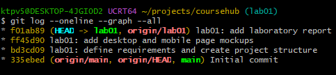
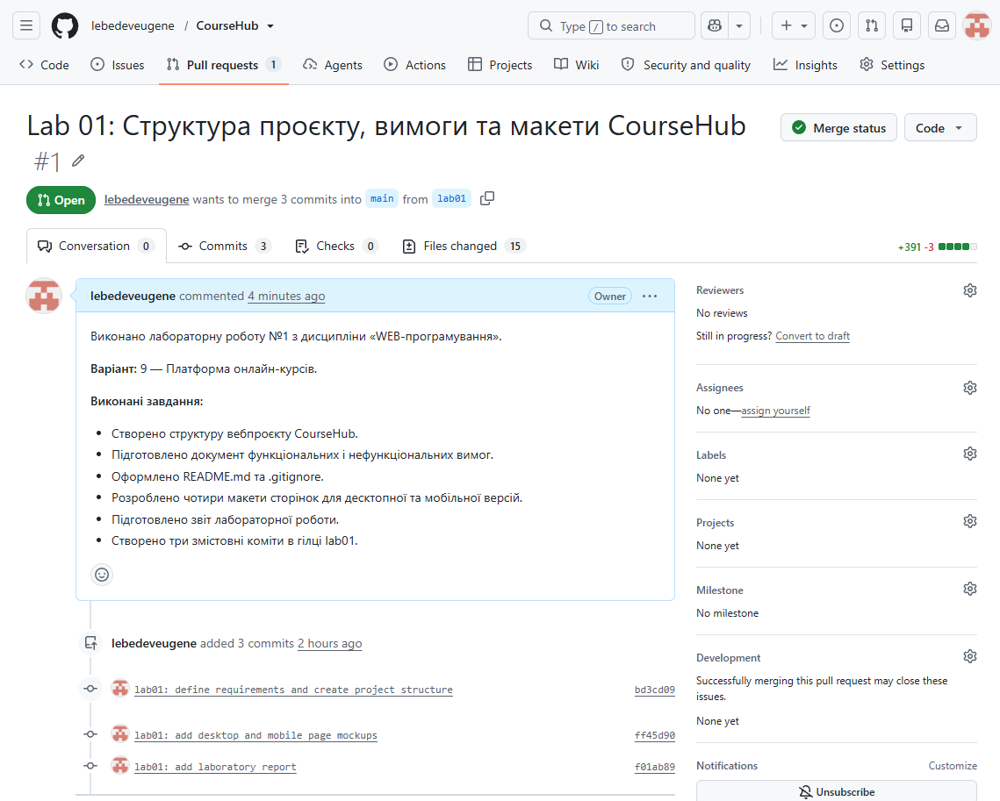

# ЗВІТ З ЛАБОРАТОРНОЇ РОБОТИ №1

**Дисципліна:** WEB-програмування

**Тема:** Визначення власного об'єкта дослідження (наскрізна задача). Структура вебпроєкту та організація репозиторію GitHub.

**Виконав:** ЛЕБЕДЄВ Є. С.

**Група:** КІ-24

**Варіант:** 9

---

## 1. Мета роботи

Обрати предметну область наскрізного проєкту, сформулювати вимоги до нього, спроєктувати структуру вебзастосунку, створити макети сторінок та організувати репозиторій GitHub для поетапної розробки проєкту протягом семестру.

## 2. Індивідуальне завдання

Відповідно до варіанта №9 обрано тему наскрізного проєкту «Платформа онлайн-курсів».

Основні сутності предметної області: Course, Lesson, Student, Enrollment.

Необхідно сформулювати функціональні та нефункціональні вимоги до вебзастосунку, визначити зв'язки між сутностями, розробити адаптивні макети сторінок, створити структуру каталогів проєкту та організувати роботу з Git і GitHub.

## 3. Хід роботи

### 3.1. Встановлення та налаштування Git

На першому етапі було перевірено наявність системи контролю версій Git за допомогою команди:

`git --version`

Налаштовано ім'я та електронну пошту автора комітів. Також встановлено назву основної гілки за замовчуванням — main.

Для налаштування використано команди:

- `git config --global user.name`
- `git config --global user.email`
- `git config --global init.defaultBranch main`

### 3.2. Створення репозиторію GitHub

На платформі GitHub створено публічний репозиторій з назвою `coursehub`.

Під час створення репозиторію додано файли README.md та .gitignore із шаблоном Node.

Для клонування репозиторію на локальний комп'ютер використано команду `git clone`.

Після клонування створено окрему гілку для виконання лабораторної роботи:

`git switch -c lab01`

### 3.3. Створення структури вебпроєкту

У редакторі Visual Studio Code організовано структуру каталогів майбутнього вебзастосунку.

Створено основні каталоги:

- `docs/` — документація проєкту.
- `docs/mockups/` — макети вебсторінок.
- `src/` — вихідний код вебзастосунку.
- `src/pages/` — сторінки застосунку.
- `src/css/` — файли стилів.
- `src/js/` — клієнтські сценарії.
- `src/assets/img/` — графічні ресурси.
- `labs/lab01/` — матеріали та звіт першої лабораторної роботи.

Також створено початковий HTML-файл `src/index.html`.

### 3.4. Формулювання вимог до проєкту

Розроблено документ `docs/requirements.md`, у якому визначено призначення вебзастосунку, основні ролі користувачів, сутності предметної області, їхні атрибути та зв'язки.

Основні сутності проєкту:

| Сутність | Призначення |
|---|---|
| Course | Зберігання інформації про навчальні курси |
| Lesson | Зберігання навчальних уроків |
| Student | Зберігання інформації про студентів |
| Enrollment | Облік записів студентів на курси |

Між сутностями Course та Lesson встановлено зв'язок «один до багатьох». Один курс може містити декілька уроків.

Сутність Enrollment використовується для реалізації зв'язку між студентами та курсами.

У документі вимог також передбачено каталог курсів, пошук, фільтрацію, перегляд уроків, форму запису на курс із валідацією та адаптивність інтерфейсу від ширини екрана 360 px.

Для подальшого зберігання інформації заплановано використання реляційної бази даних MySQL.

### 3.5. Розроблення макетів вебсторінок

Для проєктування інтерфейсу використано графічний редактор Figma.

Розроблено чотири макети вебсторінок для двох типів пристроїв:

1. Головна сторінка для комп'ютера — 1280 px.
2. Головна сторінка для мобільного пристрою — 360 px.
3. Каталог навчальних курсів для комп'ютера — 1280 px.
4. Каталог навчальних курсів для мобільного пристрою — 360 px.

На головній сторінці передбачено навігаційне меню, інформаційний банер, кнопку переходу до каталогу та картки популярних курсів.

Сторінка каталогу містить поле пошуку, фільтри та картки навчальних курсів з інформацією про рівень складності й тривалість навчання.

У мобільних версіях змінено розташування елементів для зручного перегляду на екранах невеликої ширини.

Усі макети експортовано у форматі PNG та збережено в каталозі `docs/mockups/`.

### 3.6. Оформлення README.md та .gitignore

У файлі README.md наведено назву проєкту, його призначення, основні можливості, запланований стек технологій, структуру каталогів та інформацію про виконання лабораторних робіт.

Файл .gitignore налаштовано для виключення зі системи контролю версій службових файлів, залежностей та локальних налаштувань середовища розробки.

Основні правила ігнорування:

- `node_modules/`
- `dist/`
- `.env`
- `*.log`
- `.vscode/`

### 3.7. Робота з комітами Git

Для фіксації результатів розробки використано окрему гілку `lab01`.

Перший коміт створено після підготовки структури каталогів та документації проєкту:

`git commit -m "lab01: define requirements and create project structure"`

Другий коміт створено після додавання макетів вебсторінок:

`git commit -m "lab01: add desktop and mobile page mockups"`

Третій коміт створюється після оформлення звіту лабораторної роботи:

`git commit -m "lab01: add laboratory report"`

Для перегляду історії комітів використовується команда:

`git log --oneline --graph --all`

### 3.8. Публікація змін на GitHub

Для завантаження гілки до віддаленого репозиторію використовується команда:

`git push -u origin lab01`

Після публікації змін необхідно створити Pull Request для об'єднання гілки `lab01` з основною гілкою `main`.

Після успішного злиття потрібно синхронізувати локальний репозиторій за допомогою команд:

`git switch main`

`git pull origin main`

## 4. Результати роботи

У результаті виконання лабораторної роботи підготовлено основу наскрізного вебпроєкту CourseHub.

Створено структуру каталогів, документ вимог, файли README.md та .gitignore, початковий HTML-файл і чотири адаптивні макети вебсторінок.

### 4.1. Макети вебсторінок

**Рисунок 1 — Макет головної сторінки для комп'ютера**

**Рисунок 2 — Макет головної сторінки для мобільного пристрою**

**Рисунок 3 — Макет каталогу курсів для комп'ютера**

**Рисунок 4 — Макет каталогу курсів для мобільного пристрою**

### 4.2. Структура проєкту

**Рисунок 5 — Структура каталогів вебпроєкту у Visual Studio Code**

### 4.3. Репозиторій GitHub

**Посилання на репозиторій:** https://github.com/lebedeveugene/coursehub

**Посилання на гілку lab01:** https://github.com/lebedeveugene/coursehub/tree/lab01

**Рисунок 6 — Публічний репозиторій GitHub із файлом README.md**

### 4.4. Історія комітів та Pull Request

**Посилання на історію комітів:** https://github.com/lebedeveugene/coursehub/commits/lab01/

**Посилання на Pull Request:** https://github.com/ТВІЙ-ЛОГІН/coursehub/pull/1

**Рисунок 7 — Історія комітів Git**

**Рисунок 8 — Об'єднання гілки lab01 з main через Pull Request**

## 5. Висновок

Під час виконання лабораторної роботи було обрано предметну область наскрізного проєкту відповідно до індивідуального варіанта №9 — «Платформа онлайн-курсів».

Визначено основні сутності предметної області, їхні атрибути та зв'язки, сформульовано функціональні й нефункціональні вимоги до майбутнього вебзастосунку.

Створено структуру каталогів проєкту CourseHub, підготовлено документацію та розроблено адаптивні макети головної сторінки й каталогу навчальних курсів.

Отримано практичні навички використання Git, створення комітів, роботи з гілками та організації репозиторію GitHub.

Підготовлена структура проєкту стане основою для виконання наступних лабораторних робіт із дисципліни «WEB-програмування».