# Звіт до лабораторної роботи № 2

**Дисципліна:** WEB-програмування  
**Тема:** Дослідження роботи клієнт-серверної архітектури. HTTP-запити та відповіді  
**Виконав:** Лебедєв Євген 
**Група:** КІ-24 
**Варіант:** 9  
**Наскрізний проєкт:** CourseHub - платформа онлайн-курсів

## Мета роботи

Вивчити принципи клієнт-серверної взаємодії, дослідити структуру HTTP-запитів і відповідей засобами браузера та утиліти `curl`, а також спроєктувати перелік ресурсів REST API власного наскрізного проєкту.

## Індивідуальне завдання

Для варіанта №9 дослідити публічний API **TheCocktailDB**: виконати не менше п'яти різних запитів, серед них запити з параметрами рядка, та описати структуру отриманих JSON-відповідей. Для проєкту **CourseHub** спроєктувати REST API з щонайменше вісьмома кінцевими точками, зазначити методи, коди успіху й помилок, а також описати формат повідомлення про помилку.

## Хід роботи

### Крок 1. Аналіз запитів у вкладці Network

У браузері Google Chrome відкрито [MDN Web Docs](https://developer.mozilla.org/), інструменти розробника (`F12`) і вкладку **Network**. Після оновлення сторінки досліджено перелік запитів, типи ресурсів, HTTP-методи та коди стану. У вкладці **Headers** переглянуто відомості **General**, **Request Headers**, **Response Headers**, а у вкладці **Timing** - доступні часові характеристики завантаження. Серед відповідей спостерігалися коди `200 OK` і `304 Not Modified`.

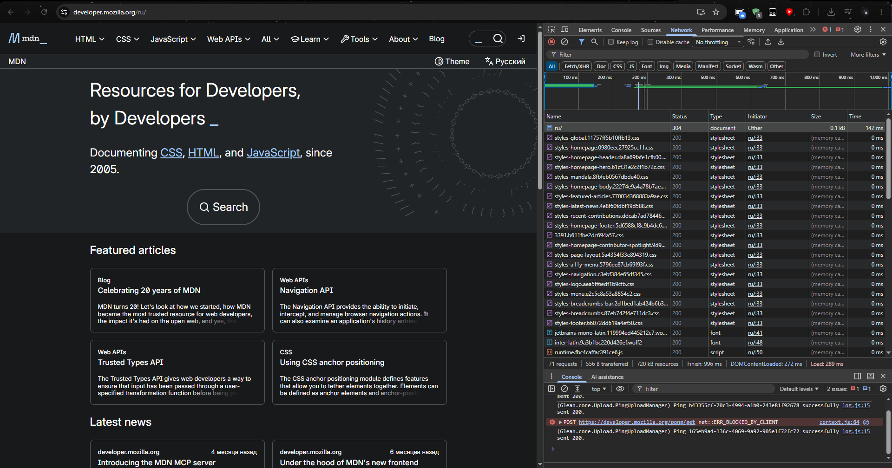

*Рисунок 1 - Дослідження HTTP-запитів та заголовків відповіді у вкладці Network.*

### Крок 2. Запити у консолі браузера

У консолі браузера виконано чотири запити до JSONPlaceholder за допомогою Fetch API:

```javascript
// Отримання одного запису
await fetch("https://jsonplaceholder.typicode.com/posts/1")
  .then(r => r.json());

// Отримання списку та виведення перших п'яти записів
var posts = await (await fetch(
  "https://jsonplaceholder.typicode.com/posts")).json();
console.table(posts.slice(0, 5));

// Отримання коментарів до першого запису
await (await fetch(
  "https://jsonplaceholder.typicode.com/posts/1/comments")).json();

// Фільтрація коментарів параметром postId
await (await fetch(
  "https://jsonplaceholder.typicode.com/comments?postId=1")).json();
```

Запити виконувалися безпосередньо на сайті JSONPlaceholder, оскільки сайт MDN використовує політику безпеки **Content Security Policy (CSP)**, яка заблокувала звернення `fetch()` до стороннього ресурсу. Перехід на JSONPlaceholder дозволив виконати завдання без вимкнення захисту браузера.

У результаті отримано JSON одного запису, таблицю перших п'яти записів, коментарі до першого запису та коментарі, відфільтровані за `postId=1`.

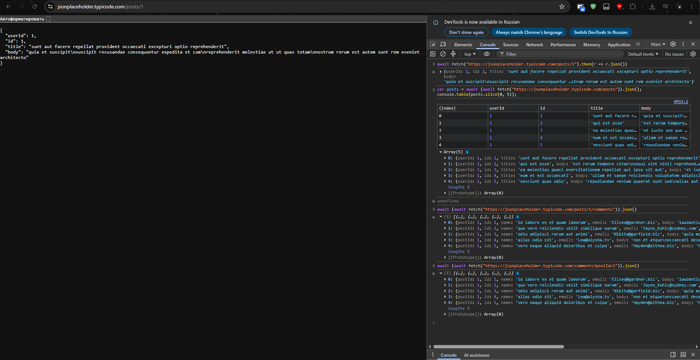

*Рисунок 2 - Виконання чотирьох HTTP-запитів до JSONPlaceholder через консоль браузера: отримання одного запису, списку записів, коментарів до запису та фільтрація коментарів за параметром `postId`.*

### Крок 3. Запити утилітою curl

У терміналі Git Bash виконано дев'ять запитів. Ключ `-i` додає заголовки HTTP-відповіді, `-I` отримує лише заголовки, а `-v` виводить детальну інформацію про з'єднання.

**GET та POST:**

```bash
curl -i https://jsonplaceholder.typicode.com/posts/1
curl -i "https://jsonplaceholder.typicode.com/posts?userId=1&_limit=3"
curl -i -X POST https://jsonplaceholder.typicode.com/posts \
  -H "Content-Type: application/json" \
  -d '{"title":"SSD 1TB","body":"test","userId":1}'
```

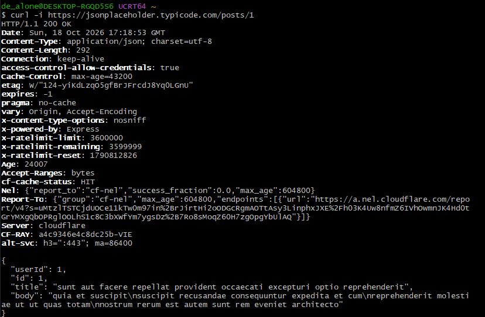

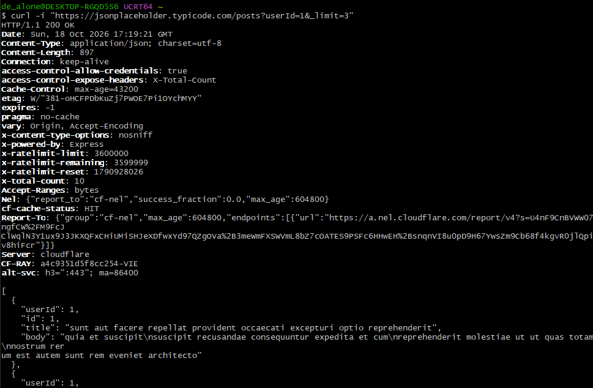

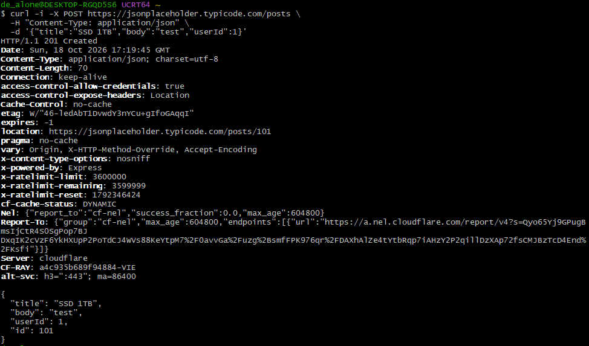

*Рисунок 3 - Виконання HTTP-запитів GET, GET з параметрами та POST за допомогою утиліти curl.*

**PUT, PATCH та DELETE:**

```bash
curl -i -X PUT https://jsonplaceholder.typicode.com/posts/1 \
  -H "Content-Type: application/json" \
  -d '{"id":1,"title":"new","body":"new","userId":1}'
curl -i -X PATCH https://jsonplaceholder.typicode.com/posts/1 \
  -H "Content-Type: application/json" \
  -d '{"title":"patched"}'
curl -i -X DELETE https://jsonplaceholder.typicode.com/posts/1
```

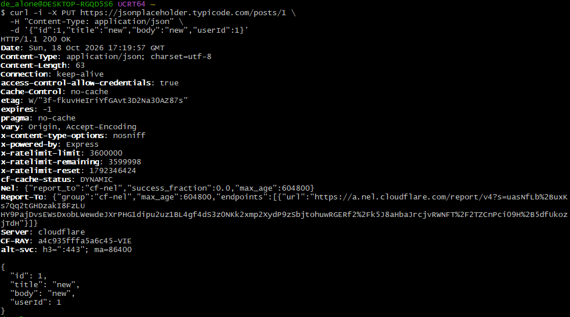

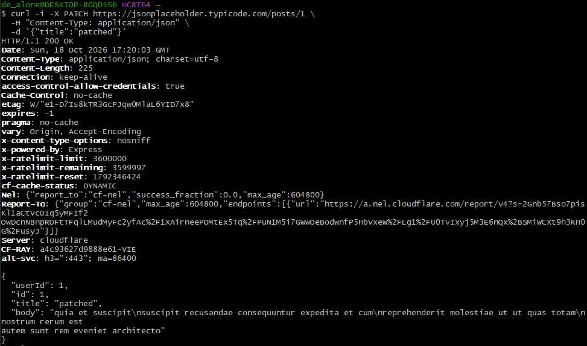

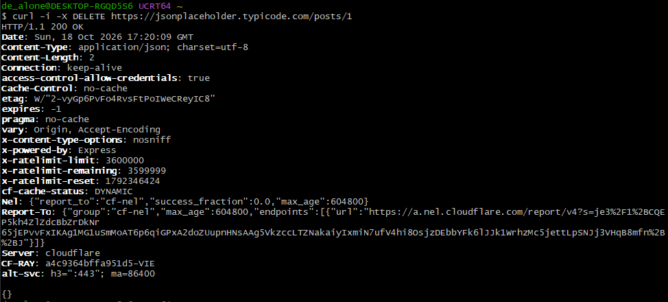

*Рисунок 4 - Виконання HTTP-запитів PUT, PATCH і DELETE для оновлення та видалення ресурсів.*

**Помилка 404, HEAD та докладний протокол:**

```bash
curl -i https://jsonplaceholder.typicode.com/posts/99999
curl -I https://jsonplaceholder.typicode.com/posts
curl -v https://api.github.com/users/octocat
```

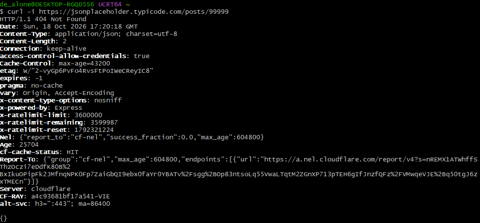

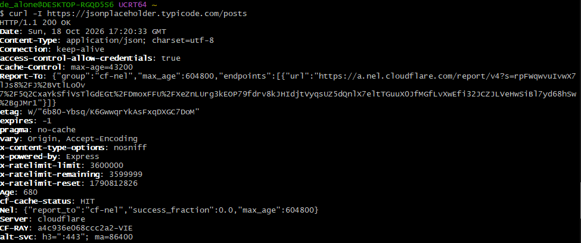

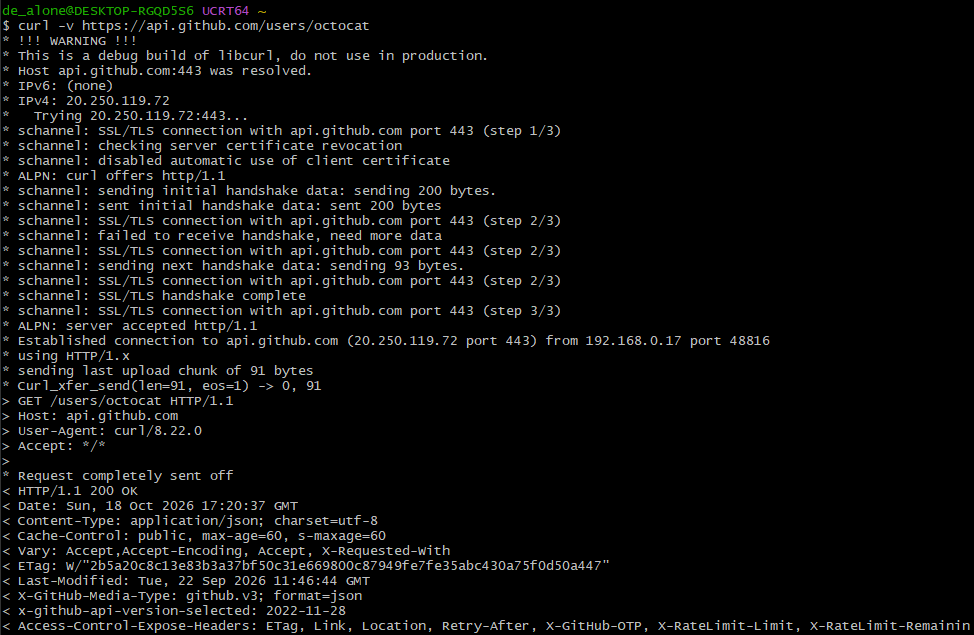

*Рисунок 5 - Дослідження відповіді 404 Not Found, HTTP-заголовків та детальної інформації про з'єднання.*

У JSONPlaceholder запити POST, PUT, PATCH і DELETE демонструють відповідні дії, але зміни даних не зберігаються постійно.

### Крок 4. Фіксація результатів дослідження

У таблиці наведено результати всіх дев'яти запитів. Для JSONPlaceholder використано базову адресу `https://jsonplaceholder.typicode.com`; трикрапка позначає скорочений фрагмент тіла.

| № | Метод і URL | Код | Ключові заголовки відповіді | Фрагмент тіла |
|---|---|---|---|---|
| 1 | GET `/posts/1` | 200 | `Content-Type: application/json`; `Cache-Control: max-age=43200` | `{"userId":1,"id":1,"title":"sunt aut facere..."}` |
| 2 | GET `/posts?userId=1&_limit=3` | 200 | `Content-Type: application/json`; `x-total-count: 10` | `[{"userId":1,"id":1,...}, ...]` |
| 3 | POST `/posts` | 201 | `Content-Type: application/json`; `Location: /posts/101` | `{"title":"SSD 1TB","body":"test","userId":1,"id":101}` |
| 4 | PUT `/posts/1` | 200 | `Content-Type: application/json`; `Cache-Control: no-cache` | `{"id":1,"title":"new","body":"new","userId":1}` |
| 5 | PATCH `/posts/1` | 200 | `Content-Type: application/json`; `Cache-Control: no-cache` | `{"userId":1,"id":1,"title":"patched",...}` |
| 6 | DELETE `/posts/1` | 200 | `Content-Type: application/json`; `Cache-Control: no-cache` | `{}` (порожній JSON-об'єкт) |
| 7 | GET `/posts/99999` | 404 | `Content-Type: application/json`; `Cache-Control: max-age=43200` | `{}` (ресурс не знайдено) |
| 8 | HEAD `/posts` | 200 | `Content-Type: application/json`; `Cache-Control: max-age=43200` | Тіло відсутнє |
| 9 | GET `https://api.github.com/users/octocat` (`curl -v`) | 200 | `Content-Type: application/json`; `Cache-Control: public, max-age=60, s-maxage=60` | JSON-об'єкт користувача GitHub |

Таким чином, досліджено успішні відповіді `200`, `201`, ситуацію відсутнього ресурсу `404`, а також HEAD-запит без тіла відповіді.

### Крок 5. Дослідження заголовків авторизації та обмежень

**Помилка 401 Unauthorized:**

```bash
curl -i https://api.github.com/user
```

GitHub API повернув `401 Unauthorized` та повідомлення `"Requires authentication"`, оскільки доступ до цього ресурсу потребує авторизації.

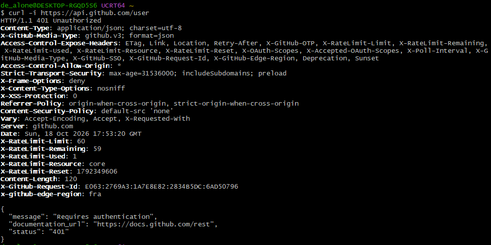

*Рисунок 6 - Отримання HTTP-коду 401 Unauthorized під час звернення до GitHub API без авторизації.*

**Обмеження кількості запитів:**

```bash
curl -i https://api.github.com/rate_limit
```

Сервер повернув `200 OK`. Під час перевірки у заголовках спостерігалися значення `X-RateLimit-Limit: 60`, `X-RateLimit-Remaining: 60` та `X-RateLimit-Used: 0`. Заголовок `X-RateLimit-Reset` визначає час оновлення ліміту у форматі Unix timestamp.

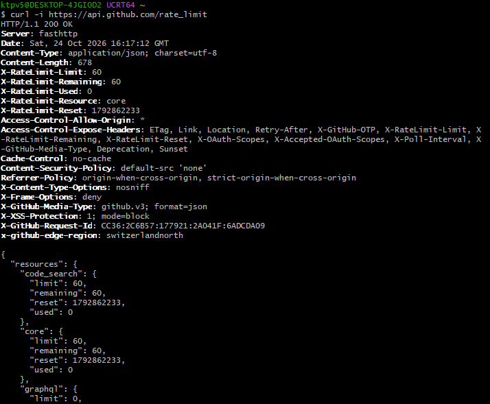

*Рисунок 7 - Перевірка обмежень кількості HTTP-запитів до GitHub API.*

**Умовний запит та 304 Not Modified:**

Спочатку отримано актуальний заголовок `ETag` ресурсу `https://api.github.com/users/octocat`, потім його значення передано серверу через `If-None-Match`:

```bash
curl -i https://api.github.com/users/octocat
# У наступному запиті підставлено точний ETag із відповіді сервера:
curl -i -H 'If-None-Match: W/"<ETag-із-відповіді>"' \
  https://api.github.com/users/octocat
```

За результатом фактично виконаного запиту отримано `304 Not Modified` без тіла JSON. Це підтверджує, що ресурс не змінився і його повторне передавання не потрібне.

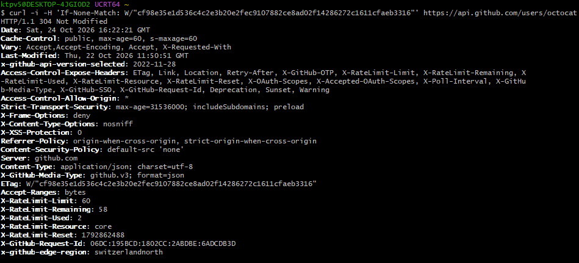

*Рисунок 8 - Отримання HTTP-коду 304 Not Modified за допомогою умовного запиту із заголовком If-None-Match.*

### Індивідуальне завдання. Дослідження публічного API (варіант 9)

Досліджено **TheCocktailDB API** ([документація](https://www.thecocktaildb.com/api.php)), який надає інформацію про коктейлі, їхні категорії, інгредієнти та способи приготування. Запити виконано за допомогою `curl` із тестовим API-ключем `1`.

**Запит №1 - Пошук коктейлю за назвою.**

```bash
curl -i "https://www.thecocktaildb.com/api/json/v1/1/search.php?s=margarita"
```

Отримано `200 OK`. У масиві `drinks` знайдено коктейль **Margarita** (`idDrink: "11007"`). Об'єкт містить назву, категорію, інструкції та інгредієнти. Параметр `s` задає назву для пошуку.

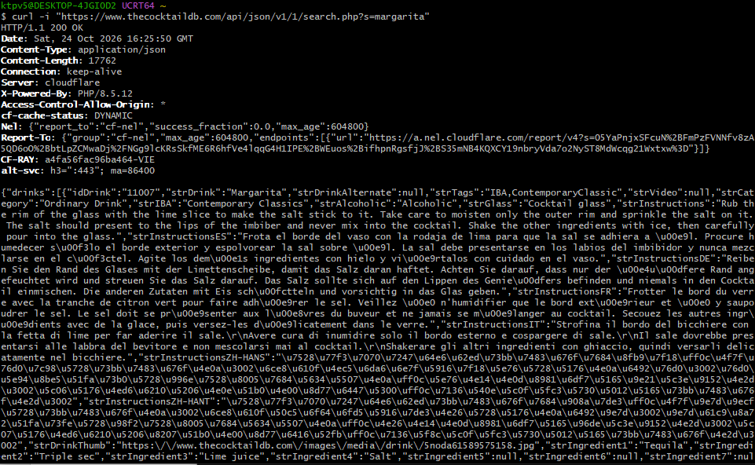

*Рисунок 9 - Пошук коктейлю Margarita за назвою за допомогою TheCocktailDB API.*

**Запит №2 - Отримання коктейлю за ідентифікатором.**

```bash
curl -i "https://www.thecocktaildb.com/api/json/v1/1/lookup.php?i=11007"
```

Отримано `200 OK`. Масив `drinks` містив об'єкт коктейлю **Margarita**. Поля `idDrink`, `strDrink`, `strCategory`, `strInstructions` та `strIngredient1` описують його ідентифікатор, назву, категорію, спосіб приготування та склад.

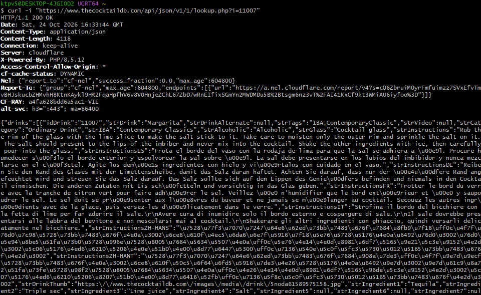

*Рисунок 10 - Отримання інформації про коктейль Margarita за унікальним ідентифікатором через TheCocktailDB API.*

**Запит №3 - Фільтрація коктейлів за інгредієнтом.**

```bash
curl -i "https://www.thecocktaildb.com/api/json/v1/1/filter.php?i=Tequila"
```

Отримано `200 OK`. У фактичній відповіді масив `drinks` містив короткі відомості про коктейль **110 in the shade**: `strDrink`, `strDrinkThumb`, `idDrink`. Параметр `i` задає інгредієнт.

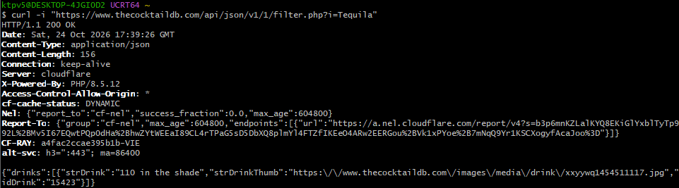

*Рисунок 11 - Фільтрація коктейлів за інгредієнтом Tequila за допомогою TheCocktailDB API.*

**Запит №4 - Отримання списку категорій коктейлів.**

```bash
curl -i "https://www.thecocktaildb.com/api/json/v1/1/list.php?c=list"
```

Отримано `200 OK`. Масив `drinks` містив об'єкти з полем `strCategory`, серед яких `Beer`, `Cocktail`, `Cocoa`, `Coffee / Tea` та інші.

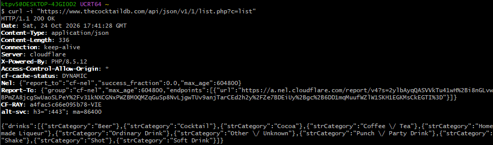

*Рисунок 12 - Отримання списку категорій коктейлів за допомогою TheCocktailDB API.*

**Запит №5 - Отримання випадкового коктейлю.**

```bash
curl -i "https://www.thecocktaildb.com/api/json/v1/1/random.php"
```

Отримано `200 OK` та інформацію про коктейль **Stone Sour** (`idDrink: "12308"`, категорія `Ordinary Drink`). Відповідь містила інструкції й перелік інгредієнтів.

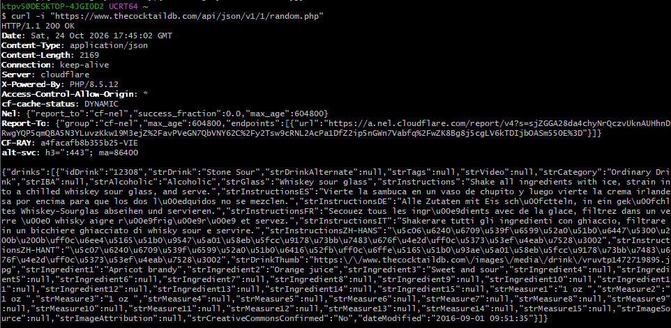

*Рисунок 13 - Отримання інформації про випадковий коктейль за допомогою TheCocktailDB API.*

**Структура JSON-відповідей.** Кореневим елементом в усіх досліджених відповідях був JSON-об'єкт із полем `drinks`, значення якого - масив. Для пошуку та перегляду коктейлю об'єкти містять повні дані (`idDrink`, `strDrink`, `strCategory`, `strInstructions`, `strIngredient1` тощо), для фільтрації - короткі відомості (`idDrink`, `strDrink`, `strDrinkThumb`), а для списку категорій - поле `strCategory`. Отже, склад полів залежить від кінцевої точки API.

### Крок 6. Проєктування API власного проєкту

На основі сутностей наскрізного проєкту **CourseHub** (Course, Lesson, Student, Enrollment) створено документ [`docs/api-design.md`](../../docs/api-design.md).

У ньому спроєктовано **14 кінцевих точок** для курсів, уроків, студентів і записів на курси, визначено методи GET, POST, PUT, PATCH, DELETE; коди успіху `200`, `201`, `204`; можливі коди помилок `400`, `401`, `403`, `404`, `409`, `422`. Передбачено фільтрацію, пошук, сортування й пагінацію за параметрами `search`, `category`, `sort`, `page`, `limit`.

Приклад запиту:

```http
GET /api/courses?category=programming&sort=price&page=1&limit=10
```

Приклад єдиного формату помилки:

```json
{
  "error": {
    "code": "COURSE_NOT_FOUND",
    "message": "Курс не знайдено",
    "status": 404
  }
}
```

Для сценарію відкриття сторінки курсу побудовано діаграму послідовності **«браузер - сервер - база даних»**. Браузер надсилає `GET /api/courses/1`, сервер шукає курс у базі даних та повертає `200 OK` із JSON. Окремо показано випадок відсутності ресурсу з кодом `404 Not Found`.

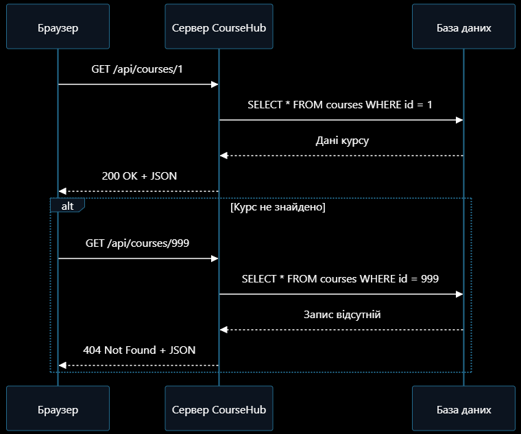

*Рисунок 14 - Діаграма послідовності взаємодії браузера, сервера CourseHub та бази даних під час отримання інформації про курс.*

Джерельний код діаграми Mermaid також розміщено у `docs/api-design.md`. REST API наразі спроєктований у вигляді документації та призначений для майбутньої реалізації.

### Крок 7. Фіксація у репозиторії

Після завершення лабораторної роботи всі результати, зокрема документ `docs/api-design.md`, звіт `labs/lab02/report.md` та знімки екрана, було збережено в окремій гілці `lab02` репозиторію CourseHub.

Для фіксації змін використано систему контролю версій Git. Створено коміт із результатами лабораторної роботи та виконано завантаження змін до віддаленого репозиторію GitHub.

## Контрольні запитання

**1. Поясніть принцип роботи клієнт-серверної архітектури у веб-середовищі.**

Клієнт надсилає HTTP-запит серверу. Сервер обробляє його, за потреби звертається до бази даних і повертає відповідь, яку браузер відображає користувачеві.

**2. Із яких частин складається HTTP-запит і HTTP-відповідь?**

Запит складається зі стартового рядка (метод, URL, версія), заголовків і необов'язкового тіла. Відповідь містить рядок стану, заголовки та необов'язкове тіло.

**3. Чим відрізняються методи GET, POST, PUT, PATCH і DELETE?**

GET отримує дані, POST зазвичай створює ресурс, PUT повністю замінює ресурс, PATCH частково його змінює, DELETE видаляє ресурс.

**4. Що означає ідемпотентність методу? Наведіть приклади ідемпотентних і неідемпотентних методів.**

Ідемпотентність означає, що повторення однакового запиту має той самий кінцевий вплив на стан сервера, що й одне виконання. Ідемпотентні: GET, PUT, DELETE. Зазвичай неідемпотентний: POST; PATCH не гарантує ідемпотентності.

**5. Назвіть групи кодів стану HTTP та наведіть по два приклади з кожної.**

1xx - інформаційні (`100 Continue`, `101 Switching Protocols`); 2xx - успіх (`200 OK`, `201 Created`); 3xx - перенаправлення й кешування (`301 Moved Permanently`, `304 Not Modified`); 4xx - помилки клієнта (`400 Bad Request`, `404 Not Found`); 5xx - помилки сервера (`500 Internal Server Error`, `503 Service Unavailable`).

**6. Які коди слід повертати у разі успішного створення, успішного видалення та помилки валідації?**

Створення - `201 Created`, видалення без тіла відповіді - `204 No Content`, помилка валідації - `422 Unprocessable Content` (або `400 Bad Request` відповідно до правил API).

**7. Що таке REST і які правила іменування ресурсів він передбачає?**

REST - архітектурний стиль взаємодії з ресурсами через уніфікований інтерфейс. URL зазвичай містять іменники у множині (`/api/courses`), а дію визначає HTTP-метод; дієслова на зразок `/getCourses` у назвах ресурсів не рекомендовані.

**8. Чому HTTP називають протоколом без збереження стану і як розв'язується задача автентифікації?**

Кожен HTTP-запит розглядається незалежно. Для автентифікації використовують cookie, серверні сесії або токени доступу, що передаються разом із запитами.

**9. Які можливості надає вкладка Network інструментів розробника?**

Network дає змогу переглядати URL, методи, коди стану, заголовки, тіла HTTP-запитів і відповідей, типи ресурсів та час їх завантаження.

**10. Що таке CORS і за яких умов браузер надсилає попередній запит OPTIONS?**

CORS - механізм контролю доступу до ресурсів з іншого джерела. Браузер виконує попередній запит OPTIONS для певних міждоменних запитів, наприклад із методом PUT, нестандартними заголовками або `Content-Type: application/json`, щоб перевірити дозвіл сервера.

**11. Для чого призначені заголовки Cache-Control, ETag і If-None-Match?**

`Cache-Control` встановлює правила кешування; `ETag` ідентифікує версію ресурсу; `If-None-Match` передає ETag серверу, щоб перевірити актуальність кешованих даних і за потреби отримати `304 Not Modified`.

## Посилання на репозиторій

- **Репозиторій:** https://github.com/lebedeveugene/coursehub
- **Гілка лабораторної роботи:** https://github.com/lebedeveugene/coursehub/tree/lab02
- **Коміти гілки:** https://github.com/lebedeveugene/coursehub/commits/lab02
- **Специфікація API:** [docs/api-design.md](../../docs/api-design.md)

## Висновки

Під час лабораторної роботи досліджено принципи клієнт-серверної взаємодії, структуру HTTP-запитів і відповідей, можливості вкладки Network та Fetch API. За допомогою `curl` виконано запити різними методами, досліджено коди `200`, `201`, `304`, `401`, `404`, механізми кешування та обмеження GitHub API. За індивідуальним варіантом №9 виконано п'ять запитів до TheCocktailDB і проаналізовано JSON-відповіді. Для платформи CourseHub спроєктовано REST API та побудовано діаграму взаємодії браузера, сервера й бази даних.
