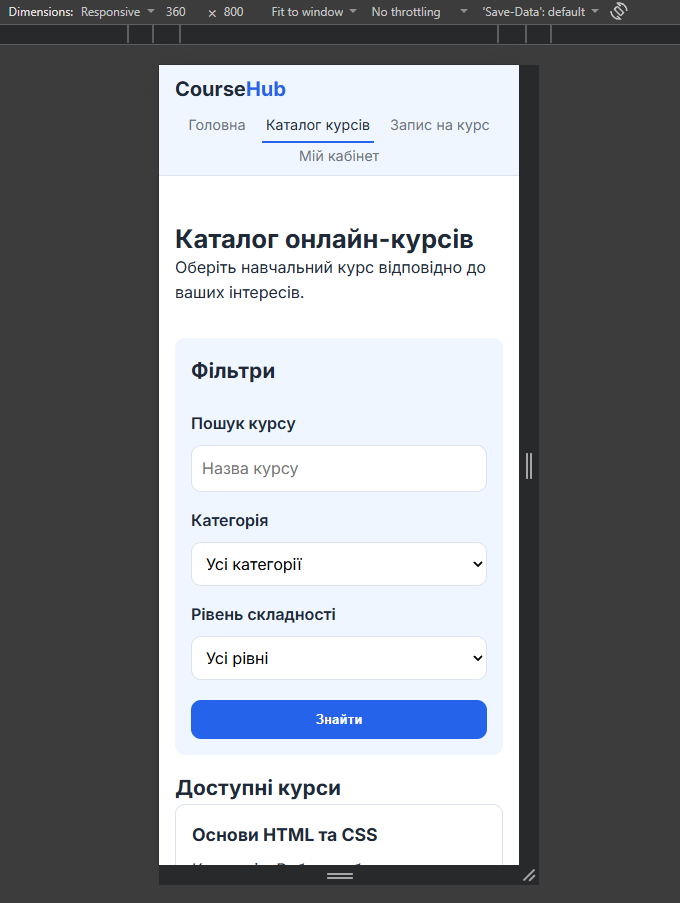
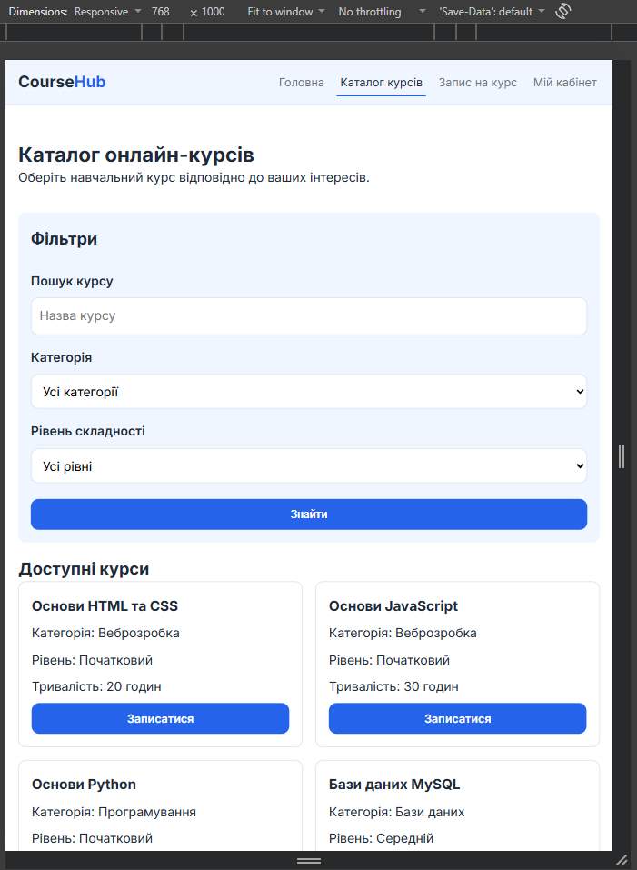
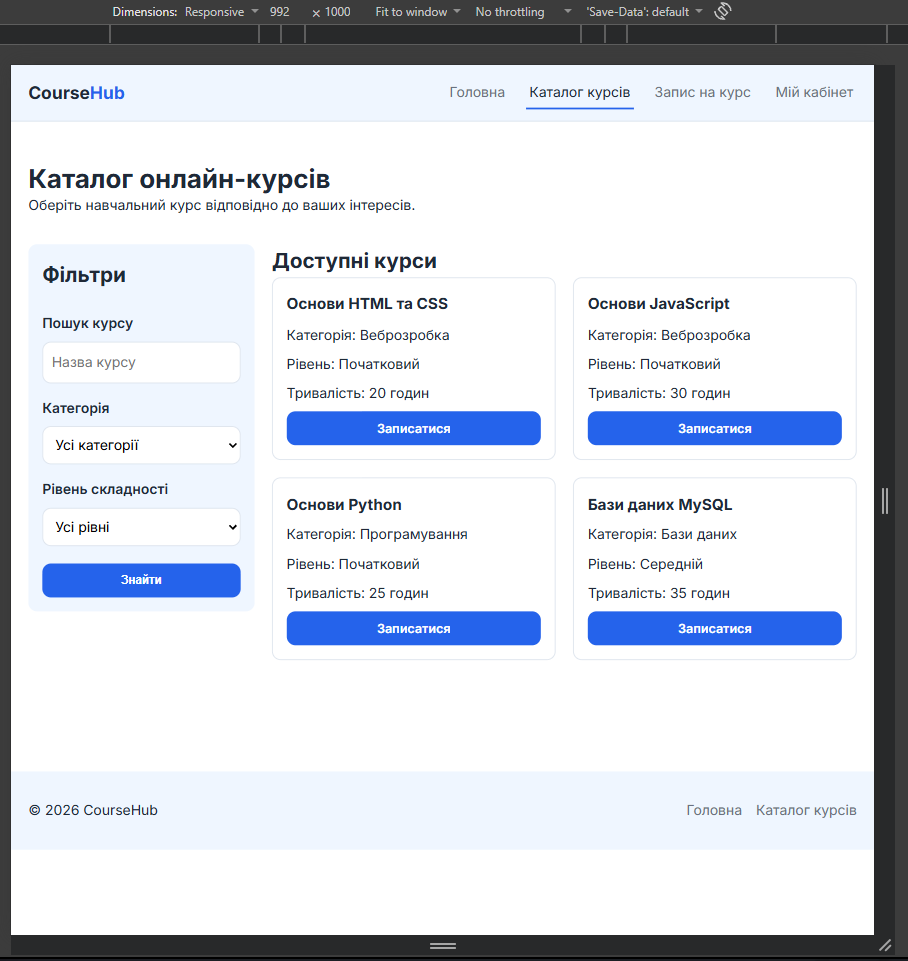
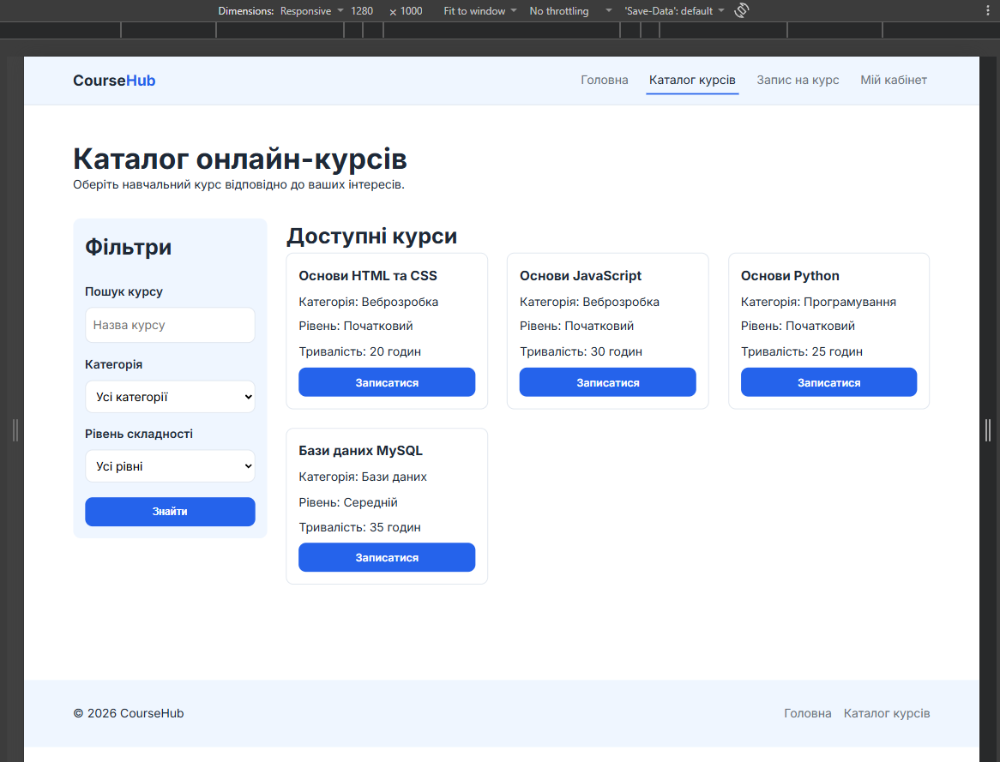
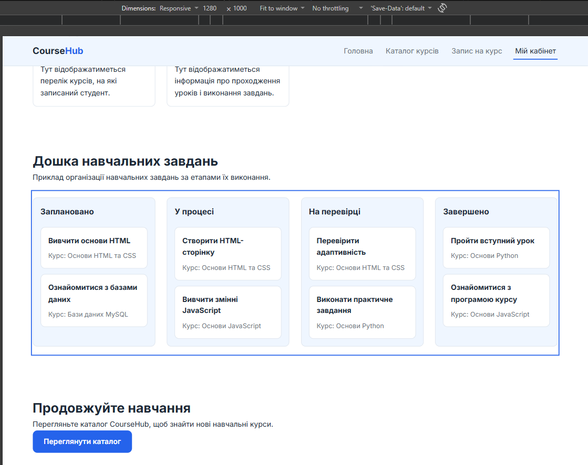
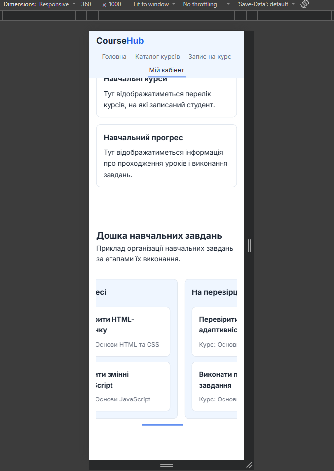
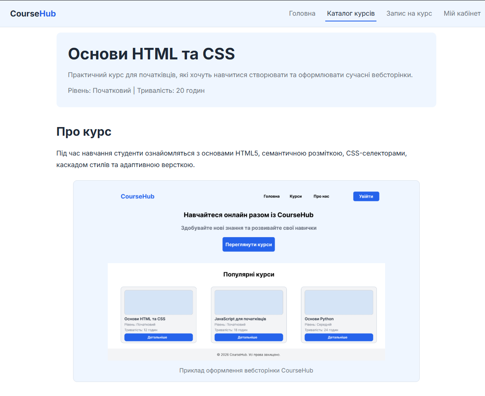
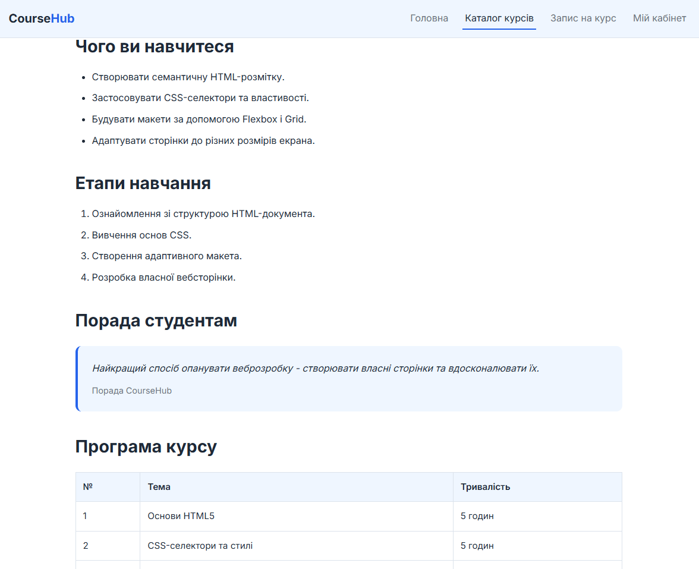

# Звіт до лабораторної роботи № 3

**Дисципліна:** WEB-програмування

**Тема:** Ознайомлення та отримання навичок роботи з каскадними таблицями стилів

**Виконав:** Лебедєв Євген

**Група:** КІ-24

**Варіант:** 9

**Наскрізний проєкт:** CourseHub - платформа онлайн-курсів

## Мета роботи

Ознайомитися з принципами роботи CSS, селекторами, каскадом і специфічністю правил, блоковою моделлю та можливостями Flexbox і CSS Grid. Навчитися створювати адаптивні сторінки з використанням CSS-змінних і медіазапитів.

## Індивідуальне завдання

Для варіанта №9 реалізувати **дошку задач із чотирьох колонок і горизонтальним прокручуванням**. Оформити заголовки, списки, цитату, зображення та таблицю на одній сторінці проєкту. Створити автоматичну сітку карток за допомогою `repeat(auto-fill, minmax(...))` без медіазапитів для зміни кількості колонок. Навести приклад конфлікту CSS-правил і пояснити результат.

## Хід роботи

### Крок 1. Семантична розмітка сторінок

У проєкті CourseHub підготовлено сторінки `src/index.html`, `src/pages/courses.html`, `src/pages/enroll.html` та `src/pages/profile.html`. Додатково створено сторінку `src/pages/course.html` з інформацією про окремий курс.

У HTML-розмітці використано семантичні елементи `header`, `nav`, `main`, `section`, `article`, `aside` та `footer`. На сторінках передбачено навігацію між головною сторінкою, каталогом, формою запису та особистим кабінетом.

### Крок 2. Створення та підключення CSS

Створено файл `src/css/style.css` із розділами змінних, скидання стилів, типографіки, макета, компонентів і медіазапитів. Для оформлення використано палітру CourseHub, визначену під час створення макетів у Figma.

```css
:root {
    --color-primary: #2563EB;
    --color-text: #1F2937;
    --color-muted: #6B7280;
    --color-bg: #FFFFFF;
    --color-surface: #EFF6FF;
    --color-image: #E8F0FB;
    --color-border: #DCE3EC;
    --radius: 10px;
    --gap: clamp(16px, 2vw, 28px);
    --container: 1200px;
}
```

Продемонстровано три способи застосування стилів: зовнішній CSS-файл через `link`, внутрішній блок `style` у документі HTML та вбудований атрибут `style` окремого елемента. Зовнішній файл зручний для спільного оформлення всіх сторінок, внутрішні стилі підходять для окремої сторінки, а вбудовані - для поодиноких змін, хоча у великому проєкті їх краще обмежувати.

```html
<link rel="stylesheet" href="../css/style.css">

<style>
    .course-detail__header {
        border: 1px solid var(--color-border);
    }
</style>

<figcaption style="font-style: italic;">
    Приклад оформлення вебсторінки CourseHub
</figcaption>
```

Реалізовано спільну «липку» шапку сайту з горизонтальним меню, станом `:hover` та виділенням активного пункту навігації.

### Крок 3. Макет сторінки каталогу на CSS Grid

Для сторінки каталогу використано CSS Grid. За достатньої ширини екрана панель фільтрів розташовується ліворуч від карток курсів, а на вузьких екранах переходить над ними.

```css
.catalog {
    display: grid;
    grid-template-columns: 260px minmax(0, 1fr);
    grid-template-areas: "filter items";
    gap: var(--gap);
}

@media (max-width: 768px) {
    .catalog {
        grid-template-columns: 1fr;
        grid-template-areas: "filter" "items";
    }
}
```

### Крок 4. Перевірка адаптивності

За допомогою інструментів розробника Chrome перевірено відображення каталогу курсів за ширини 360, 768, 992 та 1280 px. Кількість колонок карток становила відповідно 1, 2, 2 та 3. Горизонтального прокручування всієї сторінки не спостерігалося.



*Рисунок 1 - Відображення каталогу курсів за ширини 360 px.*



*Рисунок 2 - Відображення каталогу курсів за ширини 768 px.*



*Рисунок 3 - Відображення каталогу курсів за ширини 992 px.*



*Рисунок 4 - Відображення каталогу курсів за ширини 1280 px.*

Додатково перевірено режими `prefers-color-scheme: light` і `prefers-color-scheme: dark`. В обох режимах сайт зберігає світлу кольорову схему.

### Крок 5. Перевірка HTML-розмітки

Усі п'ять HTML-файлів перевірено за допомогою W3C Nu HTML Checker. Під час перевірки сторінки `course.html` виявлено помилкове розташування елементів усередині `head`. Після виправлення структури документа та повторної перевірки помилок і попереджень не залишилося.

### Індивідуальне завдання. Реалізація макета за варіантом №9

На сторінці `profile.html` реалізовано дошку навчальних завдань із чотирма колонками: «Заплановано», «У процесі», «На перевірці» та «Завершено». У кожній колонці розміщено картки завдань. За малої ширини екрана дошка прокручується горизонтально, не змінюючи кількості колонок.

```css
.task-board {
    max-width: 100%;
    overflow-x: auto;
}

.task-board__columns {
    display: grid;
    grid-template-columns: repeat(4, minmax(260px, 1fr));
    gap: var(--gap);
    min-width: 1124px;
}
```



*Рисунок 5 - Чотириколонкова дошка навчальних завдань CourseHub за ширини 1280 px.*



*Рисунок 6 - Горизонтальне прокручування дошки за ширини 360 px.*

На додатковій сторінці `course.html` оформлено типографіку та контент курсу «Основи HTML та CSS»: заголовки, маркований і нумерований списки, зображення, цитату та таблицю навчальної програми.



*Рисунок 7 - Оформлення заголовків та зображення на сторінці курсу.*



*Рисунок 8 - Оформлення списків, цитати та таблиці програми курсу.*

Для карток курсів використано автоматичну сітку CSS Grid. Функція `repeat(auto-fill, minmax(240px, 1fr))` самостійно визначає кількість колонок залежно від доступної ширини контейнера без окремих медіазапитів для цієї сітки.

```css
.cards {
    display: grid;
    grid-template-columns: repeat(auto-fill, minmax(240px, 1fr));
    gap: var(--gap);
}
```

Для демонстрації конфлікту CSS-правил розглянуто такі селектори:

```css
p {
    color: var(--color-text);
}

.course-detail__header p {
    color: var(--color-muted);
}
```

Для абзацу в `.course-detail__header` застосовується друге правило, оскільки його специфічність `(0,1,1)` вища за специфічність селектора `p` `(0,0,1)`. Отже, колір тексту буде `#6B7280`.

### Крок 6. Фіксація результатів у репозиторії

Результати лабораторної роботи підготовлено в окремій гілці `lab03` репозиторію CourseHub. HTML-сторінки та CSS розміщено в каталозі `src/`, звіт - у `labs/lab03/report.md`, а знімки екрана - у `labs/lab03/screenshots/`.

## Контрольні запитання

**1. Які існують способи підключення таблиць стилів і в чому переваги зовнішніх файлів?**

Стилі можна підключати через зовнішній файл `link`, внутрішній блок `style` або атрибут `style` безпосередньо в елементі. Зовнішній файл дозволяє повторно використовувати спільні правила на багатьох сторінках і спрощує підтримку оформлення.

**2. Як обчислюється специфічність селектора? Наведіть приклад розв'язання конфлікту правил.**

Порівнюють кількість ідентифікаторів, класів, атрибутів і псевдокласів, а потім назв елементів і псевдоелементів. Наприклад, `.card p` має специфічність `(0,1,1)`, тому за інших рівних умов переважає `p` зі специфічністю `(0,0,1)`.

**3. Чому застосування `!important` вважається поганою практикою?**

`!important` ускладнює передбачувану роботу каскаду, перевизначення стилів та подальшу підтримку коду. Зазвичай краще правильно організувати селектори й порядок правил.

**4. Опишіть блокову модель. Чим відрізняються `content-box` і `border-box`?**

Блокова модель складається з вмісту, внутрішніх відступів (`padding`), рамки (`border`) і зовнішніх відступів (`margin`). За `content-box` задані `width` і `height` стосуються лише вмісту, а за `border-box` включають також `padding` і `border`.

**5. У чому різниця між Flexbox і CSS Grid? Для яких задач застосовують кожен модуль?**

Flexbox зручний для розташування елементів переважно вздовж одного напрямку, наприклад у меню. CSS Grid призначений для двовимірних макетів із рядками й колонками, наприклад каталогу курсів або дошки завдань.

**6. Поясніть призначення властивостей `justify-content`, `align-items` і `gap`.**

`justify-content` розподіляє вільний простір між елементами вздовж головної осі Flexbox, `align-items` вирівнює елементи вздовж поперечної осі, а `gap` задає проміжки між елементами сітки або flex-контейнера.

**7. Що таке псевдоклас і псевдоелемент? Наведіть по три приклади.**

Псевдоклас описує стан або особливе положення елемента: `:hover`, `:focus`, `:first-child`. Псевдоелемент вибирає частину елемента або створює умовний вміст: `::before`, `::after`, `::first-line`.

**8. Як працює функція `repeat(auto-fill, minmax(240px, 1fr))`?**

CSS Grid створює стільки колонок, скільки може вмістити контейнер, з мінімальною шириною 240 px. За наявності вільного місця колонки можуть розширюватися завдяки `1fr`.

**9. Які одиниці вимірювання є відносними та у яких випадках їх застосовують?**

До відносних належать `%`, `em`, `rem`, `vw`, `vh` та інші. Їх використовують для розмірів, що залежать від контейнера, розміру шрифту або вікна браузера, щоб інтерфейс краще адаптувався до різних екранів.

**10. Чим відрізняються значення властивості `position: relative`, `absolute`, `fixed` і `sticky`?**

`relative` зміщує елемент від його звичайного положення зі збереженням місця в потоці. `absolute` прибирає елемент із потоку й позиціонує відносно відповідного контейнера, `fixed` - відносно вікна перегляду, а `sticky` поєднує звичайне розташування з фіксацією під час прокручування в межах контейнера.

**11. Для чого призначений метатег `viewport`?**

Метатег `viewport` задає правила відображення сторінки на мобільних пристроях. Значення `width=device-width, initial-scale=1` дозволяє використовувати фактичну ширину екрана та початковий масштаб 1.

## Посилання на репозиторій

- **Репозиторій:** https://github.com/lebedeveugene/CourseHub
- **Гілка лабораторної роботи:** https://github.com/lebedeveugene/CourseHub/tree/lab03
- **Коміти гілки:** https://github.com/lebedeveugene/CourseHub/commits/lab03
- **Головна сторінка:** [src/index.html](../../src/index.html)
- **Таблиця стилів:** [src/css/style.css](../../src/css/style.css)

## Висновки

Під час лабораторної роботи опрацьовано селектори, каскад стилів, специфічність правил, блокову модель, Flexbox і CSS Grid. Для проєкту CourseHub реалізовано спільне оформлення сторінок із CSS-змінними, адаптивний каталог курсів і три способи застосування стилів. За індивідуальним варіантом №9 створено дошку завдань із чотирма колонками та горизонтальним прокручуванням, оформлено сторінку курсу й автоматичну сітку карток. Адаптивність перевірено за чотирьох розмірів екрана, а HTML-розмітку - валідатором W3C.
